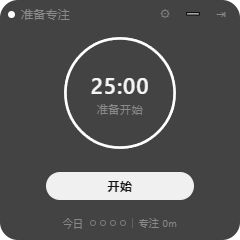
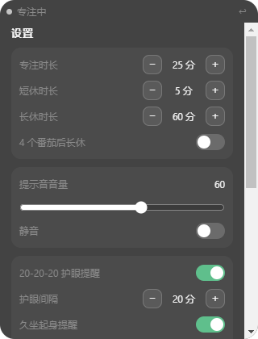
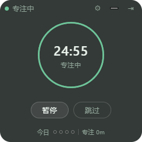
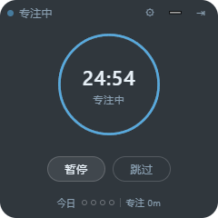
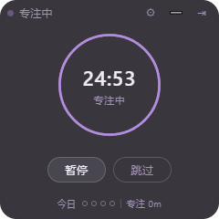

# 番茄钟桌面挂件

> 不打扰剪辑节奏的常驻桌面番茄钟：240×240 透明置顶小窗，不抢焦点、不占任务栏，到点只轻提示。

Windows 10/11 x64 · Electron 31 + React 18 + TypeScript · v0.2.2

<p align="center">
  
  
  
</p>

## 为什么是挂件

剪辑、写作或写代码时，全屏番茄钟会打断节奏。这个项目把计时器压缩成一个随时可见、但几乎不占注意力的小窗：无边框、置顶、默认不抢焦点，收起后只剩半透明的圆环和剩余时间。

## 功能

| 模块 | 能力 |
| --- | --- |
| 专注计时 | 25 分钟专注 / 5 分钟短休 / 60 分钟长休，每 4 个番茄进入长休；开始、暂停、继续、重置、跳过 |
| 低打扰提醒 | Web Audio 合成轻提示音，专注结束与休息结束两种音色；不弹系统通知、不抢焦点 |
| 桌面融合 | 240×240 透明无边框置顶窗，默认不占任务栏；拖拽顶栏移动；➖ 收起为 160×160 半透明紧凑态 |
| 专注保护 | 自动识别 DaVinci Resolve 等剪辑软件在前台时进入勿扰，提醒只保留视觉变化；也可手动勿扰 |
| 今日统计 | 今日完成番茄数、累计专注时长，本地持久化 |
| 护眼与久坐 | 20-20-20 护眼提醒、45 分钟久坐起身提醒，均可单独开关与调间隔 |
| 桌面常驻 | 托盘菜单（显示 / 设置 / 重启界面 / 退出）、关闭到托盘、开机自启 |
| 视觉主题 | 极简黑白、番茄红、森林绿、深海蓝、薰衣草、跟随系统，共 6 套；除极简外随系统明暗切换 |
| 自动更新 | 安装版从 GitHub Releases 检查、下载并静默安装新版本；绿色版提示手动覆盖 |
| 稳定性 | 渲染进程异常自动重建（限流 + 退避）、无响应强制恢复、托盘手动重启、时钟回拨保护、日志轮转 |

<p align="center">
  
  
  
</p>

## 下载与安装

**安装版（推荐）**

1. 打开 [Releases · v0.2.2](https://github.com/agkp4ever-creator/kp-dsh/releases/tag/v0.2.2)。
2. 下载 `pomodoro-widget-setup-0.2.2.exe` 并安装。
3. 安装版内置自动更新：设置 →「检查更新」，有新版本时下载并重启安装。

**绿色版**

解压后直接运行，不需要安装；更新时替换整个目录即可。绿色版不接入自动更新，设置页会提示手动下载新版本覆盖。

> 当前安装包未做代码签名，Windows SmartScreen 可能提示「未知发布者」，选择「仍要运行」即可。

系统要求：Windows 10 / 11 x64。

## 使用

- **移动**：拖动顶栏空白处。
- **收起**：点顶栏 `➖`，窗口缩到 160×160 并变为 62% 不透明度；点紧凑窗任意位置恢复。
- **设置**：点 `⚙`，可调专注/短休/长休时长、长休间隔、音量与静音、护眼/久坐开关、开机自启、勿扰、主题，以及检查更新。
- **退出**：点 `✕` 退出；点窗口关闭按钮则收进托盘继续计时。
- **托盘**：右键托盘图标可显示挂件、打开设置、重启界面或退出。

## 主题

设置面板提供 6 个选项，全部为低饱和毛玻璃风格：

| 选项 | 标识 | 明暗 |
| --- | --- | --- |
| 极简黑白 | `minimal` | 锁定深色 |
| 番茄红 | `tomato` | 随系统 |
| 森林绿 | `forest` | 随系统 |
| 深海蓝 | `ocean` | 随系统 |
| 薰衣草 | `lavender` | 随系统 |
| 跟随系统 | `system` | 极简风格 + 系统明暗 |

新增主题只需：在 `src/shared/types.ts` 的 `THEME_NAMES` 加名字 → `src/renderer/src/styles/tokens.css` 加深/浅两组变量 → `SettingsPanel.tsx` 的 `THEME_OPTIONS` 加标签。

## 性能与可靠性

- 主进程 1 秒 tick，渲染层按 1 秒快照推进圆环，不再跑 60fps rAF；窗口隐藏时停止补间。
- 勿扰探测按需调度：运行 30 秒 / 空闲 120 秒 / 隐藏 300 秒 / 检测失败 600 秒；窗口隐藏或最小化时暂停探测，提醒发送前即时探测一次（最多等 600ms）。
- 本机 5 秒 CPU 采样（5 进程合计）：运行态单核占用约 24.7% → **7.5%**，暂停态接近 0%（仅代表本机测量）。
- 渲染进程异常退出后 60 秒内最多重建 3 次，重建互斥并带 300/800/1500ms 退避；连续失败后托盘「重启界面」可手动恢复。
- 渲染进程无响应先给 5 秒宽限，仍无响应则强制重建。
- 主进程检测 `Date.now()` 回拨（阈值 1 秒），按回拨前剩余时间重锚，计时不会倒走。
- 日志超过 1MB 轮转并保留 2 份；生产构建注入 CSP。

## 更新日志

### v0.2.2

- 性能：计时圆环从 60fps rAF 改为 1fps 快照，去掉逐帧 `stroke-dashoffset` 过渡；隐藏窗口停止补间。
- 性能：勿扰前台探测降频（运行 10s → 30s），隐藏/最小化暂停；提醒前即时探测，静音判断更准。
- 发布：补齐项目介绍、功能截图、版本更新日志与 GitHub Releases 发布流程。
- 修复：自动更新源改为 GitHub Releases，安装版可直接从仓库 Release 升级。

### v0.2.1

- 崩溃自愈：渲染进程重建限流（60 秒 3 次）、退避重试、`unresponsive` 强制恢复、托盘「重启界面」。
- 自动更新：NSIS 安装包 + `latest.yml` + 应用内检查/下载/重启安装；绿色版降级为手动覆盖提示。
- 时钟回拨保护：主进程用上一 tick 快照检测系统时间回退并重锚。
- 新增森林绿、深海蓝、薰衣草三套主题，共 6 套。

### v0.2.0

- 完整桌面体验：托盘菜单、开机自启、关闭到托盘、今日统计、紧凑模式、护眼/久坐提醒。
- 勿扰模式：检测剪辑软件前台自动静音提醒，也可手动开启。
- 稳定性：单实例锁、多显示器位置恢复、空闲态改时长即时生效、跳过按实际专注时长结算。

### v0.1.0

- 首个可运行版本：透明置顶挂件、timestamp 驱动的番茄计时、圆环倒计时、轻提示音、设置持久化。

## 开发

技术栈：Electron 31、electron-vite 2、React 18、TypeScript 5、electron-updater、Playwright（e2e）。无 UI 框架，样式使用 CSS 设计 token。

```powershell
cd pomodoro_desktop_widget
$env:ELECTRON_MIRROR = 'https://npmmirror.com/mirrors/electron/'
npm install --registry=https://registry.npmmirror.com

npm run dev         # 开发模式
npm run typecheck   # 主进程 + 渲染层类型检查
npm run test:assert # 计时/崩溃/性能/收纳/窗口/主题/更新断言
npm run test:e2e    # 真实 Electron 冒烟 + 崩溃自愈
npm run release:win # 构建 + NSIS 安装包 + latest.yml
```

### 目录结构

```text
pomodoro_desktop_widget/
├── src/
│   ├── shared/    types · constants · format · timerMath · dndPolicy · crashPolicy · logPolicy
│   ├── main/      index · bootstrap · window · timer · tray · dnd · updater · settings · store · logger · autostart · ipc
│   ├── preload/   index（window.pomodoro 白名单 API）
│   └── renderer/src/
│       ├── hooks/       useTimer · useSettings · useTheme
│       ├── components/  TitleBar · TimerRing · ControlBar · SettingsPanel
│       └── styles/      tokens.css · global.css
├── tests/         assert 脚本 + e2e（smoke / crash-recovery / real-upgrade）
├── scripts/       release · serve-updates · capture-screenshots
└── docs/screenshots/
```

### 测试钩子

通过环境变量覆盖阶段时长（毫秒），便于快速验证到点流转：

```powershell
$env:POMODORO_FOCUS_MS = '8000'
$env:POMODORO_BREAK_MS = '8000'
npm run dev
```

`POMODORO_USER_DATA_DIR` 可重定向数据目录（e2e 使用）；`POMODORO_E2E=1` 跳过开机自启与勿扰探测。

### 发布

1. 更新 `package.json` 版本号。
2. `npm run release:win`，产物在 `release/`：`pomodoro-widget-setup-<version>.exe`、`latest.yml`、`.blockmap`。
3. 在 GitHub 创建 `v<version>` Release，上传上述三个文件。
4. 安装版自动更新读取 Release 中的 `latest.yml`；本地验证可用 `npm run serve:updates` + `UPDATE_URL=http://127.0.0.1:8787`。

## 数据与隐私

- 设置与统计保存在 `%APPDATA%/pomodoro_desktop_widget/pomodoro-data.json`，原子写入，损坏时回退默认值。
- 日志在 `%APPDATA%/pomodoro_desktop_widget/logs/app.log`，仅本地，不上传。
- 应用不收集任何遥测；自动更新只访问 GitHub Releases。

## 已知限制

- 仅支持 Windows x64；未做代码签名。
- 自动更新依赖 GitHub 可访问；国内网络可能需要代理。
- 今日统计仅当日，暂无历史图表/导出。
- 暂无全局快捷键、任务命名、白噪音。
- 勿扰自动检测当前匹配 DaVinci Resolve 等剪辑软件前台进程，其他软件可手动勿扰。

## 路线图

- 周/月统计视图与 CSV 导出
- 全局快捷键、任务标签
- 白噪音与更丰富的提示音
- 可选的开机启动到托盘 / 静默更新
